# Saleem A. Al Dajani

I'm an MIT PhD researcher building machine-learning systems to measure and model human aging from molecular, physiological, and behavioral data. I'm especially interested in models that connect biological mechanism with measurements people can collect continuously, such as wearables, voice, and movement.

I also hold a PhD in Applied Physics from KAUST, and an SM in Nuclear Science and Engineering and SBs in Physics and Chemical-Biological Engineering from MIT. My path has run through quantum physics and reactor materials, Harvard Medical School–affiliated research groups, single-cell sequencing at the Broad Institute, particle physics at CERN, flash-memory testing for Europa Clipper at NASA JPL/Caltech, Crew Dragon avionics and launch engineering at SpaceX, and consulting at McKinsey.

**Get in touch:** [Email](mailto:sdajani@mit.edu) · [Google Scholar](https://scholar.google.com/citations?user=lsjHsT8AAAAJ&hl=en) · [LinkedIn](https://www.linkedin.com/in/saleemaldajani) · [X / Twitter](https://x.com/saleemaldajani) · [Instagram](https://www.instagram.com/saleemaldajani/) · [ORCID](https://orcid.org/0000-0003-4116-6616) · [Math Genealogy](https://www.genealogy.math.ndsu.nodak.edu/id.php?id=323587)

I welcome collaborations at the intersection of machine learning, aging biology, digital health, and scientific tool-building.

# Academic Lineage

  <a href="https://www.genealogy.math.ndsu.nodak.edu/id.php?id=323587">
    <picture>
      <source media="(prefers-color-scheme: dark)" srcset="assets/academic-lineage-dark.svg">
      <source media="(prefers-color-scheme: light)" srcset="assets/academic-lineage-light.svg">
      
    </picture>
  </a>

The [Mathematics Genealogy Project](https://www.genealogy.math.ndsu.nodak.edu/id.php?id=323587) traces my line through my KAUST advisor, David Keyes, back to [Isaac Newton](https://www.genealogy.math.ndsu.nodak.edu/id.php?id=74313) in 15 steps and [Galileo Galilei](https://www.genealogy.math.ndsu.nodak.edu/id.php?id=134975) in 18. Its records continue on to [Desiderius Erasmus](https://www.genealogy.math.ndsu.nodak.edu/id.php?id=125938) in 21 steps and [Omar Khayyam](https://www.genealogy.math.ndsu.nodak.edu/id.php?id=295739) in 31.

Closer to home, my academic grandfather, [Donald G. M. Anderson](https://www.genealogy.math.ndsu.nodak.edu/id.php?id=28540), introduced [Anderson acceleration](https://doi.org/10.1145/321296.321305) in 1965. Six decades later, David Keyes and I used his method to [accelerate AI on GPUs](https://arxiv.org/abs/2410.19460).

Follow the full line, record by record

 

[Saleem Al Dajani](https://www.genealogy.math.ndsu.nodak.edu/id.php?id=323587) → [David E. Keyes](https://www.genealogy.math.ndsu.nodak.edu/id.php?id=39446) → [Donald G. M. Anderson](https://www.genealogy.math.ndsu.nodak.edu/id.php?id=28540) → [Max Krook](https://www.genealogy.math.ndsu.nodak.edu/id.php?id=66420) → [Arthur S. Eddington](https://www.genealogy.math.ndsu.nodak.edu/id.php?id=18250) → [Alfred N. Whitehead](https://www.genealogy.math.ndsu.nodak.edu/id.php?id=78732) → [Edward J. Routh](https://www.genealogy.math.ndsu.nodak.edu/id.php?id=101929) → [William Hopkins](https://www.genealogy.math.ndsu.nodak.edu/id.php?id=42016) → [Adam Sedgwick](https://www.genealogy.math.ndsu.nodak.edu/id.php?id=102043) → [Thomas Jones](https://www.genealogy.math.ndsu.nodak.edu/id.php?id=102036) → [Thomas Postlethwaite](https://www.genealogy.math.ndsu.nodak.edu/id.php?id=133301) → [Stephen Whisson](https://www.genealogy.math.ndsu.nodak.edu/id.php?id=133367) → [Walter Taylor](https://www.genealogy.math.ndsu.nodak.edu/id.php?id=133368) → [Robert Smith](https://www.genealogy.math.ndsu.nodak.edu/id.php?id=103068) → [Roger Cotes](https://www.genealogy.math.ndsu.nodak.edu/id.php?id=103067) → **[Isaac Newton](https://www.genealogy.math.ndsu.nodak.edu/id.php?id=74313)** → [Isaac Barrow](https://www.genealogy.math.ndsu.nodak.edu/id.php?id=67643) → [Vincenzo Viviani](https://www.genealogy.math.ndsu.nodak.edu/id.php?id=133302) → **[Galileo Galilei](https://www.genealogy.math.ndsu.nodak.edu/id.php?id=134975)**

# Projects

▶️ marks a live demo you can open in your browser, and 📄 marks an associated paper.

## Aging and Health AI

* 🧬 mAge integrates plasma proteomics, wearables, and mortality hazard to predict biological age, intrinsic capacity, and mortality risk, with clocks across 49 organ and cell-type subsystems
  * 📄 [Preprint, under review at *Cell*, 2026](https://doi.org/10.64898/2026.05.08.26352759)
* ⏳ HallmarkAge builds binarized, hallmark-aware transcriptomic clocks to discover aging mechanisms
  * 📄 [ICLR GEM Workshop, 2026](https://openreview.net/forum?id=sx5bpASbKG)
* 🔬 [DeepSeq](https://github.com/saleemaldajani/deepseq) labels cell types in single-cell RNA-sequencing data using LLMs, in a pipeline covering filtering, clustering, UMAP visualization, reports, and an interactive Dash app
  * 📄 [*Machine Learning: Health*, 2026](https://doi.org/10.1088/3049-477x/ae8550) · [ICML FM4LS Workshop, 2025](https://openreview.net/forum?id=zNjXOZxEYB)
* 🙂 [FaceTTD](https://github.com/saleemaldajani/facettd) explores whether longitudinal facial images can predict time-to-death, with experiments on IMDb and out-of-distribution evaluation on Wikipedia data
  * 📄 [NeurIPS TS4H and Imageomics Workshops, 2025](https://openreview.net/forum?id=dS7H27vww8)

In progress, with no public code yet: multimodal aging and health models using data from the All of Us Research Program.

## Creative AI

* 🎤 [The Rap Mixer](https://github.com/saleemaldajani/rap-mixer) shows how an artist's performance choices interact with a chosen cultural context, producing several transparent scores instead of one universal rating
  * Supports recorded analysis, a live four-bar stream, and constrained revision suggestions, with free local or bring-your-own-key modes

## Interactive Science

* 🧲 [The Levitron Lab](https://github.com/saleemaldajani/levitron-lab) is a set of browser-based simulations of magnetic levitation, organized around the ways real devices escape Earnshaw's theorem
  * ▶️ [Try it live](https://levitron-lab-production.up.railway.app/)
* 🏜️ [Mohr Planes of Sand](https://github.com/saleemaldajani/mohrplanesofsand) connects the Mohr circle, the Mohr–Coulomb failure envelope, and the angle of repose of a sand dune
  * ▶️ [Try it live](https://mohrplanesofsand-production.up.railway.app/)
* 📐 [Gadget Assembly](https://github.com/saleemaldajani/gadgetassembly) generates spiky ring (shuriken) geometries from interactive sliders, inspired by computational geometry
  * 📄 [NeurIPS Creative AI Track, 2025](https://openreview.net/forum?id=5uxw5CIVtC)
* ✨ [Scatter](https://github.com/saleemaldajani/scatter) is a tiny click-to-chase ball game where the balls bolt away from your clicks
  * ▶️ [Play it live](https://scatter-production.up.railway.app/)

## Materials Science

* ⚛️ [elastopya](https://github.com/saleemaldajani/elastopya) holds the code, inputs, data, and figures for a manuscript in preparation on first-principles evidence of stiffening during spinodal decomposition in FeCr
  * 📄 Builds on our [*Acta Materialia* paper](https://doi.org/10.1016/j.actamat.2022.118552), which won an [Acta Student Award](https://actamaterialia.org/awards/acta-student-awards) and was covered by [MIT News](https://news.mit.edu/2023/nuclear-power-reactors-testing-0110)

## Early Notebooks

* 📊 [Data](https://github.com/saleemaldajani/data) collects my 2017 notebooks on web scraping IMDb in Python and R and simulating random draws in R

# Selected Papers

* **S. A. Al Dajani** et al. [A multimodal framework for organ- and cell-resolved biological aging and longevity intervention discovery](https://doi.org/10.64898/2026.05.08.26352759). Preprint, under review at *Cell*, 2026.
* **S. A. Al Dajani** et al. [HallmarkAge: Binarized hallmark-aware transcriptomic clocks to discover aging mechanisms](https://openreview.net/forum?id=sx5bpASbKG). *ICLR GEM Workshop*, 2026.
* **S. A. Al Dajani**, A. Sanchez, J. R. Williams. [DeepSeq: High-throughput single-cell RNA sequencing data labeling via web search-augmented agentic generative AI foundation models](https://doi.org/10.1088/3049-477x/ae8550). *Machine Learning: Health*, 2026. Earlier version at the ICML FM4LS Workshop, 2025 ([OpenReview](https://openreview.net/forum?id=zNjXOZxEYB)).
* **S. A. Al Dajani**, D. E. Keyes. [Accelerating AI performance using Anderson extrapolation on GPUs](https://arxiv.org/abs/2410.19460). *NeurIPS MLNCP Workshop*, 2024 ([OpenReview](https://openreview.net/forum?id=wkP2ZFRn9e)).
* **S. A. Al Dajani**, D. E. Keyes. [Constructing artificial life and materials scientists with accelerated AI using Deep AndersoNN](https://arxiv.org/abs/2407.19724). *ICML ML4LMS Workshop*, 2024 ([OpenReview](https://openreview.net/forum?id=qhwyvhqAvI)).
* **S. A. Al Dajani**, F. Laquai. [Machine learning nominal max oxygen consumption from wearable reflective pulse oximetry with density functional theory](https://doi.org/10.1101/2024.07.15.603651). *ICML ML4LMS Workshop*, 2024 ([OpenReview](https://openreview.net/forum?id=vbovwWp8iS)).
* **S. A. Al Dajani**, H. Soller. [Noise as a probe for Majorana bound states](https://doi.org/10.1142/S0217979225501061). *International Journal of Modern Physics B*, 2025 ([arXiv](https://arxiv.org/abs/2212.03076)).
* **S. A. Al Dajani** et al. [Detecting thermally-induced spinodal decomposition with picosecond ultrasonics in cast austenitic stainless steels](https://doi.org/10.1016/j.actamat.2022.118552). *Acta Materialia*, 2023. 🏆 [Acta Student Award](https://actamaterialia.org/awards/acta-student-awards), 2022 ([MIT News](https://news.mit.edu/2023/nuclear-power-reactors-testing-0110)).
* A. P. C. Wylie, K. B. Woller, **S. A. Al Dajani**, et al. [Thermal diffusivity in ion-irradiated single-crystal iron, chromium, vanadium, and tungsten measured using transient grating spectroscopy](https://doi.org/10.1063/5.0089048). *Journal of Applied Physics*, 2022.

See [Google Scholar](https://scholar.google.com/citations?user=lsjHsT8AAAAJ&hl=en) for the full list.
